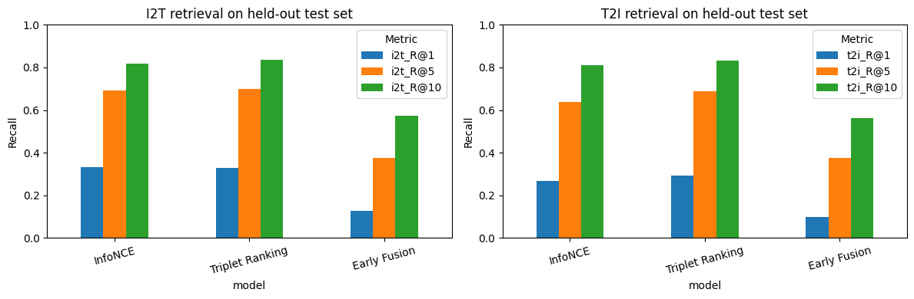
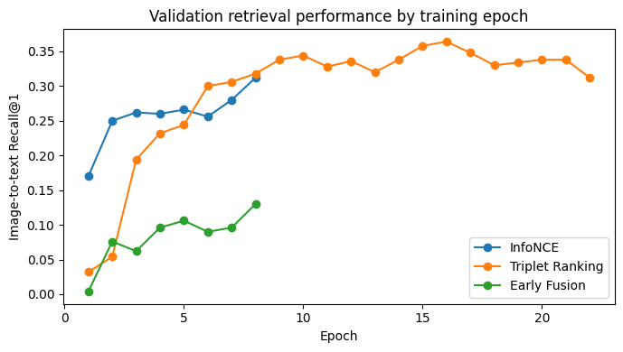

# Bidirectional Image–Caption Retrieval (COMP 6011 Project 2.2)

**Individual implementation:** Pranav Kadari · **Student ID:** a1987287

This project compares **symmetric InfoNCE**, **top-k Triplet Ranking** and **Early Fusion** for both image-to-caption and caption-to-image retrieval on a 5,000-image COCO 2017 subset with 25,010 captions. The models are trained independently on the same shared **precomputed** ResNet-50 and BERT features.

> **Scope:** The COCO feature archive was produced as shared project input; the three downstream retrieval approaches and comparisons are recorded in the executed individual notebook. The archive, original images and large `.pt` model weights are intentionally excluded from this repository.

## Test results

| Model | I→T R@1 | I→T R@5 | I→T R@10 | I→T MRR | T→I R@1 | T→I R@5 | T→I R@10 | T→I MRR |
|---|---:|---:|---:|---:|---:|---:|---:|---:|
| InfoNCE | 33.40% | 69.20% | 81.80% | 0.4889 | 26.89% | 63.76% | 81.14% | 0.4337 |
| Triplet Ranking | 33.00% | 70.00% | 83.60% | 0.4920 | **29.28%** | **68.68%** | **83.30%** | **0.4611** |
| Early Fusion | 12.80% | 37.60% | 57.20% | 0.2557 | 9.95% | 37.63% | 56.17% | 0.2390 |

Triplet leads on seven of eight metrics, though overlapping individual 95% bootstrap intervals do **not** establish significant superiority over InfoNCE. Early Fusion is much slower at exhaustive pair scoring, approximately **10.53s versus 0.072s** for InfoNCE in these recorded CPU experiments; this excludes original feature-extraction time.


## Repository structure

```text
COMP6011-Image-Caption-Retrieval/
├── README.md
├── COMP6011_Image_Caption_Retrieval.ipynb
├── test_metrics.csv
├── bootstrap_ci.csv
├── data_quality.png
├── retrieval_comparison.png
├── validation_curves.png
├── execution_environment.txt
├── requirements.txt
├── DATA_AND_REPRODUCIBILITY.md
└── .gitignore
```

## Quick start (Colab or Jupyter)

1. Download `multimodal_shared_data.zip` from the approved shared project files (not part of this repository). The archive must contain `shared_data/coco_splits.json`, `shared_data/image_features.pt`, `shared_data/text_features.pt` and `results/dataset_audit.json`.
2. Open `COMP6011_Image_Caption_Retrieval.ipynb` in Colab, upload the ZIP when prompted (or place it in the working directory). **Do not extract it yourself.**
3. Install dependencies (local Jupyter): `python -m pip install -r requirements.txt`. In Colab, the main dependencies may already be present; check your runtime before reinstalling PyTorch.
4. Choose **Runtime → Run all**. The notebook verifies the image/caption mapping, trains all three approaches, computes retrieval metrics and writes local results to `individual_coco_results/`.
5. Compare the generated individual_coco_results/test_metrics.csv and figures with the archived test_metrics.csv and PNG figures stored in the repository root.

**Splits:** 4,000 train images (20,008 captions), 500 validation (2,499 captions), 500 test (2,503 captions). All splits are image-disjoint and use seed 42.


## Visual results






## Method overview

- **InfoNCE:** two 512-hidden-layer MLP projection heads into a shared 256D space, symmetric temperature-scaled contrastive loss (temperature 0.07), 8 epochs.
- **Triplet Ranking:** same dual encoder architecture, top-8 hard negatives with a 0.25-weighted all-negative term, margin 0.2, validation-selected epoch 16.
- **Early Fusion:** 256D image/text projections, concatenation with their absolute difference into 768D pair representation; binary match scorer.

All models use the same train/validation/test data, compare Recall@1/5/10 and MRR in both retrieval directions, and save graphs and evaluation artifacts.

## Reproducibility and ethics

See [Data and reproducibility notes](DATA_AND_REPRODUCIBILITY.md). Experimental limitations include one seed, frozen features, potential COCO captioning bias and untested demographic fairness. This is research coursework, not a production retrieval service.

## References

- Lin, T.-Y. et al. (2014). *Microsoft COCO: Common Objects in Context*. ECCV. https://arxiv.org/abs/1405.0312
- He, K. et al. (2016). *Deep Residual Learning for Image Recognition*. CVPR. https://arxiv.org/abs/1512.03385
- Devlin, J. et al. (2019). *BERT: Pre-training of Deep Bidirectional Transformers for Language Understanding*. NAACL. https://arxiv.org/abs/1810.04805
- Radford, A. et al. (2021). *Learning Transferable Visual Models From Natural Language Supervision*. ICML. https://arxiv.org/abs/2103.00020
- Faghri, F. et al. (2018). *VSE++: Improving Visual-Semantic Embeddings with Hard Negatives*. BMVC. https://arxiv.org/abs/1707.05612

## AI-use transparency

Generative AI tools were used to assist with code development, debugging, model optimisation, experimental analysis, documentation, and the preparation of the implementation report and presentation materials.

AI assistance included troubleshooting implementation issues, improving the Triplet Ranking approach, interpreting evaluation metrics, organising experimental results, and improving the clarity and structure of written explanations.

The project uses the shared COCO dataset and precomputed ResNet-50 and BERT features. The final experimental results were obtained from the executed Jupyter Notebook. All AI-assisted content should be reviewed and verified for technical accuracy and compliance with the university's academic integrity requirements.
